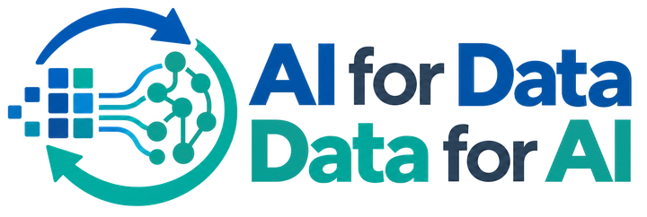
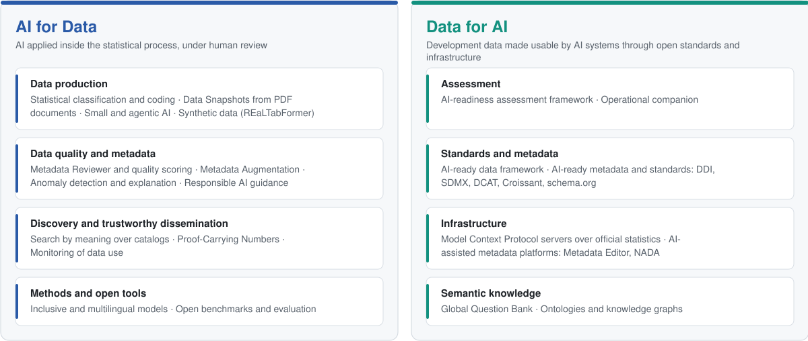

<p align="center">
  <picture>
    <source media="(prefers-color-scheme: dark)" srcset="website/static/img/program-logo-dark.png">
    
  </picture>
</p>

<h1 align="center">AI for Data – Data for AI</h1>

<p align="center">
Methods, software, and guidance from a work program of the World Bank's Development Data Group and Office of the Chief Statistician.<br>
AI applied to the production, curation, and dissemination of development data, and development data prepared for use by AI systems.
</p>

<p align="center">
  <a href="https://worldbank.github.io/ai4data/"></a>
  <a href="https://pypi.org/project/ai4data/"></a>
  <a href="https://www.npmjs.com/package/@ai4data/search"></a>
  <a href="https://pypi.org/project/ai4data/"></a>
  <br>
  <a href="https://github.com/worldbank/ai4data/actions/workflows/cookbook-scripts.yml"></a>
  <a href="https://github.com/worldbank/ai4data/actions/workflows/reference-implementation.yml"></a>
  <a href="https://github.com/worldbank/ai4data/actions/workflows/gh-pages.yml"></a>
  <a href="LICENSE"></a>
  <a href="LICENSE-CONTENT.md"></a>
</p>

<p align="center">
  <a href="https://worldbank.github.io/ai4data/">Documentation</a> ·
  <a href="https://worldbank.github.io/ai4data/hub">Implementation hub</a> ·
  <a href="https://worldbank.github.io/ai4data/tools">Tools catalogue</a> ·
  <a href="https://worldbank.github.io/ai4data/cookbook/">Cookbooks</a> ·
  <a href="https://worldbank.github.io/ai4data/ai-readiness-assessment">Readiness assessment</a> ·
  <a href="training/README.md">Training</a>
</p>

---

## Motivation

People increasingly put questions about poverty, employment, climate, and food security to AI systems. Whether the answers draw on official statistics depends on whether an AI system can find the data, interpret the meaning of a number, retrieve the authoritative value, and show its source. When it cannot, the system falls back on secondary sources that may be outdated or wrong.

Four gaps are common among data producers.

| Gap | Effect | Workstreams |
|---|---|---|
| **Metadata is incomplete or inconsistent** | A dataset with a vague title, missing keywords, or a definition that contradicts its name does not appear in a search for its subject. | [Metadata Reviewer](https://worldbank.github.io/ai4data/docs/metadata-reviewer/overview), [Metadata Augmentation](https://worldbank.github.io/ai4data/docs/metadata-augmentation/), [Generative AI for metadata quality](https://worldbank.github.io/ai4data/docs/metadata-quality/generative-ai-for-metadata-quality) |
| **Context is thin** | Units, classifications, breaks in series, and revisions are absent from the machine-readable record, so a number is easy to misread. | [Anomaly detection and explanation](https://worldbank.github.io/ai4data/docs/anomaly-detection/), [AI-ready data framework](https://worldbank.github.io/ai4data/docs/ai-ready-framework), [Data Snapshots](https://arxiv.org/abs/2606.06242) |
| **Data are hard for software to reach** | Statistics sit in PDF tables and spreadsheets, and where an API exists, each organization has its own. | [Model Context Protocol for statistics](https://worldbank.github.io/ai4data/docs/mcp/), [Data discoverability](https://worldbank.github.io/ai4data/docs/data-discoverability/), [Monitoring of data use](https://worldbank.github.io/ai4data/docs/data_use/) |
| **Answers cannot be traced** | A figure in a generated answer rarely links to its source record, so a wrong or outdated value goes unnoticed. | [Proof-Carrying Numbers](https://worldbank.github.io/ai4data/docs/pcn/), [End-to-end reference implementation](https://worldbank.github.io/ai4data/docs/reference-implementation/) |

The program's position follows the UN Fundamental Principles of Official Statistics: AI supports statistical systems and does not replace them, a person remains responsible for the organization's publications, and the methods and software are published as open resources.

## Two pillars

<p align="center">
  <picture>
    <source media="(prefers-color-scheme: dark)" srcset="docs/images/program-pillars-dark.svg">
    
  </picture>
</p>

The [AI-ready data framework](https://worldbank.github.io/ai4data/docs/ai-ready-framework) defines the attributes of AI-ready data under FAIR with two added dimensions, trustworthy and inclusive, and names the workstream for each dimension. The [mapping to the GSBPM](https://worldbank.github.io/ai4data/docs/gsbpm-mapping) places each workstream in the statistical production process.

## Example outputs

The outputs are recorded runs of the methods. The [home page of the documentation](https://worldbank.github.io/ai4data/) shows the same examples.

<details>
<summary><b>Search by meaning over a catalog.</b> The query and the matching indicator titles share no words.</summary>

<br>

Query: *how many people go hungry in the Philippines*. Ranking by cosine similarity with the open embedding model `avsolatorio/GIST-all-MiniLM-L6-v2`:

| Score | Indicator |
|---|---|
| 0.796 | Prevalence of severe food insecurity in the population (%) |
| 0.786 | Prevalence of moderate or severe food insecurity in the population (%) |
| 0.783 | Survey mean consumption or income per capita, total population (2021 PPP $ per day) |
| 0.781 | Survey mean consumption or income per capita, bottom 40% of population (2021 PPP $ per day) |

The same query can be sent by an AI agent as a Model Context Protocol tool call. The [data discoverability](https://worldbank.github.io/ai4data/docs/data-discoverability/) page describes the indexing, and the [PI-FT toolkit](research/pift-toolkit/README.md) fine-tunes an embedding model on an organization's own structured records.

</details>

<details>
<summary><b>Metadata review by five agents.</b> Input: one metadata record. Output: ranked issues with suggested corrections, for a curator to accept or reject.</summary>

<br>

Input: a World Development Indicators series record whose name reads "GDP per capita (curent US$)" and whose measurement unit reads "Constant 2015 US$". Five agents run in sequence: primary detection, secondary detection, a critic that drops candidates outside the review scope, a categorizer, and a severity scorer. Output:

```json
[
  {
    "detected_issue": "Measurement unit contradicts the name and definition...",
    "issue_category": "Inconsistency / Conflict",
    "issue_severity": 4,
    "current_metadata": {"series_description.measurement_unit": "Constant 2015 US$"},
    "suggested_metadata": {"series_description.measurement_unit": "Current US$"}
  },
  {
    "detected_issue": "Typo in series name: 'curent' should be 'current'.",
    "issue_category": "Typo / Language",
    "issue_severity": 2,
    "current_metadata": {"series_description.name": "GDP per capita (curent US$)"},
    "suggested_metadata": {"series_description.name": "GDP per capita (current US$)"}
  }
]
```

The reviewer runs as a Python package, through a review app, and inside the open-source [Metadata Editor](https://github.com/worldbank/metadata-editor) as an optional add-on. See the [user manual](https://worldbank.github.io/ai4data/docs/metadata-reviewer/user-manual/).

</details>

<details>
<summary><b>Anomaly explanation with cited evidence.</b> A flagged point in a time series receives a classification, a confidence, and cited evidence.</summary>

<br>

Series: GDP growth (annual %), Nigeria, from the World Development Indicators. Values for 2013 to 2017: 6.67, 6.31, 2.65, −1.62, 0.81. A statistical detector flags 2016. The elicitation pipeline returns:

```json
{
  "classification": "external_driver",
  "confidence": 0.92,
  "explanation": "Nigeria experienced a sharp GDP contraction in 2016, its first recession in 25 years, driven by the collapse in global oil prices beginning in 2014–2015 and militant attacks on oil infrastructure in the Niger Delta.",
  "evidence_strength": "strong_direct",
  "evidence_source": [{"name": "Nigeria GDP recession 2016, oil price collapse", "date_range": "2015-2016", "source_type": "economic_crisis", "verifiability": "well_documented"}]
}
```

Each explanation is one of four classes: external driver, data error, measurement update, or insufficient data. A reviewer approves, rejects, or corrects it in the [review app](apps/anomaly_review/README.md). The [elicitation pipeline](https://worldbank.github.io/ai4data/docs/anomaly/explanation/elicitation-pipeline) page gives the schema and the prompts.

</details>

<details>
<summary><b>Number verification in a chatbot answer.</b> Each number carries a tag with its source record; the application compares the two and draws the mark.</summary>

<br>

Question: *How fast did the Philippines' economy grow in 2024?* The application holds the retrieved record: GDP growth (annual %), Philippines, 2024, value 5.71474526128652, from the World Development Indicators, claim id `0328`.

| The model writes | Outcome |
|---|---|
| `The economy grew by <claim id="0328">5.7</claim>% in 2024.` | Verified: 5.7 matches the record under the rounding policy. |
| `The economy grew by <claim id="0328">6.0</claim>% in 2024.` | Flagged: 6.0 does not match the record. |
| `The economy grew by 6.0% in 2024.` | No mark: no source tag, so the number was never checked. |

The model cannot draw the mark, and a number without a tag is never marked verified. A mark means that the number matches the cited record under the stated policy. It does not mean that the record, the method behind it, or the interpretation is right. Protocol, specification, and packages: [worldbank/pcn](https://github.com/worldbank/pcn); paper: [arXiv:2509.06902](https://arxiv.org/abs/2509.06902).

</details>

<details>
<summary><b>Dataset mentions in documents.</b> Zero-shot named-entity recognition finds the datasets used in a report or paper, including name variants.</summary>

<br>

The extractor reads a PDF page by page and returns each mention with its text, a confidence, and a specificity tag: named ("World Development Indicators 2023"), descriptive ("national poverty line estimates"), or vague. Variants such as "WDI" and "World Development Indicators" are harmonized to one canonical dataset and deduplicated, so that use of a dataset across a corpus can be counted.

```python
from ai4data.data_use import extract_from_document

for page in extract_from_document("policy_report.pdf", include_confidence=True):
    for ds in page["datasets"]:
        name = ds.get("mention_name") or {}
        print(page["page"], name.get("text"), name.get("confidence"), ds.get("specificity_tag"))
```

See [Monitoring of data use](https://worldbank.github.io/ai4data/docs/data_use/).

</details>

<details>
<summary><b>Data snapshots from PDF documents.</b> A layout detection model locates a figure or table on a page, and the region is converted to structured data.</summary>

<br>

The [benchmark paper](https://arxiv.org/abs/2606.06242) compares open-source layout detection models on institutional documents, and the [data-snapshot toolkit](experimental/data-snapshot/README.md) holds the code and points to the [benchmark dataset](https://huggingface.co/datasets/ai4data/data-snapshot).

</details>

## Where to start

| Role | Start at |
|---|---|
| An engineer building an application on official statistics | The [end-to-end reference implementation](reference/end_to_end/README.md), one run from documentation to verification, and the [training series](training/README.md) |
| A curator or data producer | The [Metadata Reviewer user manual](https://worldbank.github.io/ai4data/docs/metadata-reviewer/user-manual/) and the cookbooks on [microdata documentation](https://worldbank.github.io/ai4data/cookbook/microdata-documentation/) and [metadata curation](https://worldbank.github.io/ai4data/cookbook/metadata-curation-with-llms/) |
| A manager at a statistical office | The [AI-readiness assessment](https://worldbank.github.io/ai4data/ai-readiness-assessment) (twelve dimensions, four maturity levels) and its [operational companion](https://worldbank.github.io/ai4data/ai-readiness-in-practice) (tools and recipes per dimension) |
| A researcher | The [papers](#research-and-papers) and the [PI-FT toolkit](research/pift-toolkit/README.md) |
| Anyone choosing a tool | The [tools catalogue](https://worldbank.github.io/ai4data/tools): status with evidence, stack, licence, installation guide, and known limits for each tool |

## Install

### Python package

```bash
pip install ai4data              # core
pip install "ai4data[all]"       # every capability
```

Each capability is an optional extra.

| Extra | Capability |
|---|---|
| `datause` | Dataset mention extraction from text and PDF documents (GLiNER, PyMuPDF) |
| `harmonization` | Clustering and deduplication of dataset names across a corpus |
| `anomaly` | Anomaly detection and explanation of flagged points in time series |
| `search` | Semantic search over catalog records (sentence-transformers, FAISS) |
| `metadata` | Schema mapping, PDF-to-metadata extraction, and metadata augmentation |
| `discovery` | NADA catalog access, metadata templates, and PDF helpers |
| `metadata-reviewer` | The five-agent review pipeline, combined with one provider extra: `openai`, `anthropic`, `azure`, or `ollama` |
| `data-snapshot` | Figure and table images from PDFs |
| `data-snapshot-metadata` | Validated Data Snapshot Metadata Schema v1.4 metadata from snapshot images through OpenRouter or OpenAI |

For the Data Snapshot pipeline, combine `data-snapshot` and `data-snapshot-metadata`. These extras are absent from `ai4data==0.1.0`; until a release includes them, follow the [source installation instructions](src/ai4data/data_snapshot/README.md#installation). In this checkout, `all` includes DocLayout-YOLO and snapshot metadata extraction. TF-ID is installed separately; the [usage guide](src/ai4data/data_snapshot/README.md) describes its dependency requirements and the three commands.

<details>
<summary>Example: review a metadata record</summary>

<br>

```bash
pip install "ai4data[metadata-reviewer,openai]"
```

```python
from ai4data.metadata.reviewer import MetadataReviewerClient

client = MetadataReviewerClient.from_openai(model="gpt-4o", api_key="sk-...")
job = client.submit(metadata_dict)     # returns at once; the pipeline runs in the background
result = job.wait_sync(timeout=300)
```

The [quick start](https://worldbank.github.io/ai4data/docs/metadata-reviewer/user-manual/quick-start) shows the same call for Anthropic, Azure OpenAI, and a local Ollama model.

</details>

### JavaScript packages

Published under the `@ai4data` npm organization, one folder per package under `packages/ai4data/`.

```bash
npm install @ai4data/search    # semantic search in the browser: HNSW, BM25, hybrid ranking, in a Web Worker
npm install @ai4data/core      # shared utilities
```

```ts
import { SearchClient } from '@ai4data/search'

const client = new SearchClient('https://example.org/data/collection/manifest.json')
client.on('index_ready', () => client.search('climate finance', { topK: 10, mode: 'hybrid' }))
client.on('results', ({ data }) => console.log(data))
```

To work on the packages, run `npm install` at the repository root, then `npm run build` for all workspaces or `npm run build --workspace=@ai4data/search` for one. [Repository structure](docs/repo-structure.md) describes the layout and how to add a package.

### Reference implementation

One command runs the full pipeline on the cookbooks' example organization: document five series and one survey in the World Bank schemas, validate them, publish a catalog with schema.org records, serve it through an MCP server, answer a question from the tool results, and verify every number in the answer with the Proof-Carrying Numbers engine.

```bash
cd reference/end_to_end
pip install -r requirements.txt
python run.py --out build                  # every number verifies: PASS, exit 0
python run.py --out build --inject-error   # one wrong number is flagged: FAIL, exit 1
```

Two runs are committed under `reference/end_to_end/sample_run/`, and the same script runs in CI on every change.

## Cookbooks

Step-by-step guides for statistical organizations. Each is built around one example organization, with scripts that run in CI. The cookbooks are working drafts, with a version, a date, and a draft banner on every chapter. They are working material of the program and do not represent official World Bank Group guidance or policy.

<details>
<summary>The eleven published cookbooks</summary>

<br>

**Data products that AI can use**

- [AI-ready data dissemination](https://worldbank.github.io/ai4data/cookbook/ai-ready-dissemination/)
- [AI-ready microdata documentation](https://worldbank.github.io/ai4data/cookbook/microdata-documentation/)
- [Extracting data from documents](https://worldbank.github.io/ai4data/cookbook/data-from-documents/)
- [Publishing ML-ready datasets](https://worldbank.github.io/ai4data/cookbook/ml-ready-datasets/)

**Metadata and interfaces**

- [Metadata curation with language models](https://worldbank.github.io/ai4data/cookbook/metadata-curation-with-llms/)
- [Serving official statistics to AI agents](https://worldbank.github.io/ai4data/cookbook/serving-statistics-to-agents/)

**Models inside the office**

- [Language models in statistical production](https://worldbank.github.io/ai4data/cookbook/language-models-in-production/)
- [Small and open models for statistical offices](https://worldbank.github.io/ai4data/cookbook/small-and-open-models/)
- [Synthetic data for sharing](https://worldbank.github.io/ai4data/cookbook/synthetic-data-for-sharing/)

**Measurement**

- [Evaluation suites for statistical AI](https://worldbank.github.io/ai4data/cookbook/evaluation-suites/)
- [Monitoring data use](https://worldbank.github.io/ai4data/cookbook/monitoring-data-use/)

The sources are under [`cookbook/`](cookbook/), and the [authoring guide](cookbook/authoring/index.md) states the cookbook standard and the checks that enforce it.

</details>

## Training

The [training series](training/README.md) holds session plans, slide decks, notebooks, worked-example assets, demonstration scripts, and participant resources. Session 01, [Building AI applications for research and data](training/session-01-building-ai-applications/README.md), is 90 minutes of slides and six guided notebooks on one worked example, followed by a hands-on lab. The notebooks open in Google Colab and run without an API key; model calls fall back to recorded, labelled outputs.

## Research and papers

| Paper | Code and data |
|---|---|
| [Proof-Carrying Numbers: a presentation-layer protocol for numeric fidelity in generated text](https://arxiv.org/abs/2509.06902) | [worldbank/pcn](https://github.com/worldbank/pcn) |
| [Field Order Should Not Matter: Permutation-Invariant Embedding Model Fine-Tuning for Structured Metadata Retrieval](https://arxiv.org/abs/2606.30473) | [PI-FT toolkit](research/pift-toolkit/README.md) |
| [Benchmarking Open-Source Layout Detection Models for Data Snapshot Extraction from Institutional Documents](https://arxiv.org/abs/2606.06242) | [data-snapshot toolkit](experimental/data-snapshot/README.md), [dataset](https://huggingface.co/datasets/ai4data/data-snapshot) |

Synthetic tabular and relational data generation is in a separate repository, [REaLTabFormer](https://github.com/worldbank/REaLTabFormer).

## Related repositories

| Repository | Contents |
|---|---|
| [worldbank/pcn](https://github.com/worldbank/pcn) | Proof-Carrying Numbers: specification, shared fixtures, TypeScript packages under `@pcn-js`, and the Python core `pcn-core` |
| [worldbank/data360-mcp](https://github.com/worldbank/data360-mcp) | MCP server over the World Bank Data360 platform, in operation with a public endpoint and releases on PyPI |
| [worldbank/data-ai-chatbot](https://github.com/worldbank/data-ai-chatbot) | Self-hostable chat application over any MCP server, with Proof-Carrying Numbers marks on the numbers in its answers |
| [worldbank/metadata-editor](https://github.com/worldbank/metadata-editor) | Open-source Metadata Editor, with the Metadata Reviewer available as an optional add-on |
| [worldbank/metadata-schemas](https://github.com/worldbank/metadata-schemas) | World Bank metadata schemas (JSON Schema) for indicators, indicator databases, microdata, geospatial data, documents, tables, images, videos, scripts, and resources, with a Python library and Excel templates |
| [ihsn/nada](https://github.com/ihsn/nada) | NADA data catalog, into which semantic search and an MCP server are being integrated |

## Repository layout

```
ai4data/
├── src/ai4data/          Python package: anomaly, data_use, data_snapshot, discovery, metadata (augmentation, reviewer)
├── packages/ai4data/     JavaScript packages: @ai4data/core, @ai4data/search
├── reference/end_to_end/ Reference implementation with committed sample runs
├── cookbook/             Cookbook sources and their scripts
├── docs/                 Workstream documentation, frameworks, and the Metadata Reviewer manual
├── training/             Training series: sessions, notebooks, decks, assets
├── research/             PI-FT toolkit
├── experimental/         Data-snapshot toolkit
├── apps/                 Anomaly explanation review app
├── notebooks/            Worked notebooks on anomaly explanation, metadata quality, and the reviewer
├── scripts/              Metadata, search, and documentation utilities
├── tests/                Package and cookbook-script tests
└── website/              Docusaurus site published at worldbank.github.io/ai4data
```

## Status of the work

Each tool on the [tools catalogue](https://worldbank.github.io/ai4data/tools) has one of five statuses, from in operation to in development, with the supporting evidence and the check date. The status describes the software and makes no claim about adoption outside the World Bank. Draft pages carry a draft banner.

## Contributing

Bug reports, installation test records, and feature requests go to the [issues](https://github.com/worldbank/ai4data/issues). [CONTRIBUTING.md](CONTRIBUTING.md) describes how changes are proposed, and the [code of conduct](CODE_OF_CONDUCT.md) applies in the repositories and their discussions.

## Citation

```bibtex
@software{ai4data,
  author       = {{Development Data Group, World Bank}},
  title        = {AI for Data -- Data for AI},
  url          = {https://github.com/worldbank/ai4data},
  year         = {2026}
}
```

[CITATION.cff](CITATION.cff) holds the same reference in machine-readable form. Each paper has its own citation.

## Contact

Development Data Group, World Bank: [aifordata@worldbank.org](mailto:aifordata@worldbank.org). Organizations planning an adoption or a joint implementation are welcome to write.

## License

The code in this repository is licensed under the MIT License together with the World Bank IGO Rider, both in [LICENSE](LICENSE). The Rider is procedural: it reserves the privileges and immunities of the World Bank and adds no restriction to the MIT permissions.

The documentation, the cookbooks, and the other text, figures, and website content under `docs/`, `cookbook/`, `research/*/docs/`, and `website/` are licensed under the [Creative Commons Attribution 4.0 International License](https://creativecommons.org/licenses/by/4.0/) unless otherwise specified, as stated in [LICENSE-CONTENT.md](LICENSE-CONTENT.md). The guides and cookbooks are working material of the program; they do not represent official World Bank Group guidance or policy and are not legal advice.
