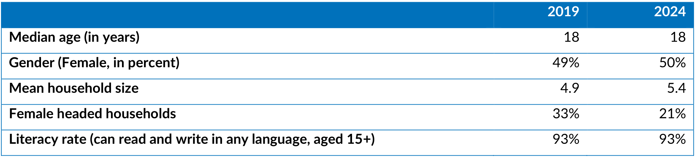

import Recipe from '@site/src/components/Cookbook/Recipe';
import Checklist from '@site/src/components/Cookbook/Checklist';

# 5. Council deliberation and the next policy

**Question:** How do the reviewed findings become a policy for the next round?

## Rationale

The findings and human decisions from [Chapter 4](./review-findings.mdx) explain what happened on particular images. The council’s task is to turn those observations into instructions that will also help on other data snapshots. Several models may draw different lessons from the same evidence. Collecting their first proposals independently gives the council several approaches to consider.

Council members then test one another’s proposals against other images. This is how the council can keep a change that helps D1 without introducing an unsupported title for C1. The orchestrator uses the revised proposals to produce the candidate policy and records what changed, why, and which questions the next round needs to address.

## Target state

- The deliberation record preserves proposals, critiques, revisions, and synthesis.
- Each accepted policy change can be traced to evidence and a decision.
- The next state retains unresolved cases and the reasons for rejected changes.

## Maturity levels

| Level | Steps |
|---|---|
| **Foundational** | Use a written deliberation record and review the proposed changes side by side. |
| **AI-ready** | Use stable finding and rule IDs and capture each stage of deliberation separately. |
| **AI-native** | Specify separate model sessions, checks that all proposals are in, and validation before saving the next policy and state. |

:::info[Running example]
Three illustrative council members propose changes based on D1, D2, and C2. C1 supplies a counterexample to an overbroad title fallback. The orchestrator synthesizes P002 and S002 for the next batch.
:::

## Recipes

<Recipe title="5.1 Collect independent proposals" level="AI-ready" skills="Experiment lead and ML engineer" time="40 minutes">

**Result:** The deliberation record contains independently written proposals based on the same evidence.

Start with F01 in the [judge reviews](pathname:///cookbook-files/data-snapshot-metadata-council/001_judge_reviews.jsonl). The judge points to “Percent of population” beside D1’s vertical axis and to the separate caption above the chart. A council member can check the finding against the image and propose clearer instructions.

Give each council member the image, output, and judge’s summary. Keep full Discovery references in the judge and human review contexts.

1. Gather the images, [starting policy (P001)](pathname:///cookbook-files/data-snapshot-metadata-council/001_policy.md), [starting state (S001)](pathname:///cookbook-files/data-snapshot-metadata-council/001_experiment_state.md), and [extraction outputs](pathname:///cookbook-files/data-snapshot-metadata-council/001_extractions.jsonl). Add the findings and human decisions cleared for the council in Chapter 4.
2. Give each member its own session with access limited to those materials. Collect all first proposals before sharing proposals among members.
3. Request the finding, visible evidence, and failure mode. Ask the member to specify whether to add, amend, retain, or retire a rule and to name the affected ID or mark it as a new rule. Include the expected benefit and a counterexample or risk. Record proposed gold or schema challenges for human review.

**Worked example.** Member A proposes amending R02 so the extractor uses the caption when the layout distinguishes it from the axis label. A also proposes a short generic title when the data snapshot has no title. That second clause aims to keep the field useful, but it needs a counterexample check. [Illustrative deliberation record](pathname:///cookbook-files/data-snapshot-metadata-council/001_deliberation.md)

**What this does not do.** Independent contexts help preserve distinct first responses. Models may still share assumptions, training data, or systematic errors.

</Recipe>

<Recipe title="5.2 Cross-critique proposals and record revisions" level="AI-ready" skills="Experiment lead" time="30 minutes">

**Result:** Each proposal has cross-critiques and a revised recommendation that addresses them.

Consider Member A’s proposal to “Use a short generic title when a data snapshot has no title to keep the field populated.” Try applying it to C1.

Ask each member to test proposed wording against the evidence this way. A critique should show where the rule helps or where it would lead to an unsupported value.

1. Share the frozen first proposals with the other members. Request a critique of each proposal that identifies the evidence or counterexample.
2. Ask each member to revise its own recommendation. Record both versions so the orchestrator can see how the rationale changed.
3. Preserve unresolved disagreement for synthesis. Route any new gold or schema concern to the human reviewer.

**Worked example.** Member B tests A's proposal against C1. The table body is visible, but the caption falls outside the snapshot. A generic title would supply wording the image does not show. Member C adds that a printed document label has its own field. A drops the fallback and revises the proposal to distinguish the visible title, axis labels, and document label. The revision aims to address D1's title error while preserving C1's null title.

**What this does not do.** Agreement among council members supplies a reason to consider a rule. Its quality still needs independent assessment.

</Recipe>

<Recipe title="5.3 Check the next policy and experiment state" level="AI-ready" skills="Experiment lead and metadata reviewer" time="45 minutes">

**Result:** The round produces a candidate policy, cumulative state, and findings with an audit trail.

Start with Member A’s revised proposal in the [deliberation record](pathname:///cookbook-files/data-snapshot-metadata-council/001_deliberation.md). A keeps the distinction between a caption and an axis label and drops the generic title fallback after reviewing C1. This is the recommendation the orchestrator needs to assess.

The policy records the new instruction. The round findings explain why it changed, and the updated state carries decisions and open questions into the next batch.

1. Check the orchestrator’s decision on each proposal against the cited evidence, known counterexamples, and human decisions. The [round findings](pathname:///cookbook-files/data-snapshot-metadata-council/001_round_findings.md) should say what was accepted, rejected, or deferred and why.
2. Compare the [candidate policy (P002)](pathname:///cookbook-files/data-snapshot-metadata-council/002_policy.md) with [P001](pathname:///cookbook-files/data-snapshot-metadata-council/001_policy.md). An amendment keeps the rule ID, an addition gets a new one, and a retired ID stays reserved.
3. Check the [updated state (S002)](pathname:///cookbook-files/data-snapshot-metadata-council/002_experiment_state.md) for decisions and open questions the next batch needs. Confirm that the [manifest](pathname:///cookbook-files/data-snapshot-metadata-council/001_manifest.json) identifies P002 and S002 as outputs and still identifies P001 as the policy used for extraction.

**Worked example.** The round findings record why the orchestrator accepts the narrower R02 amendment. D1 supports distinguishing a caption from an axis label, and C1 supports dropping the fallback.

> **R02** Use an identifiable visible title or caption for the title. Treat axes, legends, and group headings according to their visual roles. Record a printed figure or table identifier separately as the document label.

The orchestrator also amends R03 and adds R05, which requires evidence for each unit association. S002 carries the unresolved counted entity in C2 and the need to test unit associations on fresh images. [Updated state](pathname:///cookbook-files/data-snapshot-metadata-council/002_experiment_state.md) · [Round findings](pathname:///cookbook-files/data-snapshot-metadata-council/001_round_findings.md)

[Chapter 6](./progress.mdx) uses those records to decide whether to run another batch, investigate an issue, or move to independent evaluation.

**What this does not do.** Synthesis produces a candidate for the next batch. Human authorization still governs any gold or schema change.

</Recipe>

## Implementation options

- Start with a structured Markdown record that preserves the order of contributions.
- Use structured proposal records if software needs to match proposals and critiques automatically. Keep the evidence references and reasons readable.

## Resources

- The [role instructions](pathname:///cookbook-files/data-snapshot-metadata-council/role-instructions.md) define the proposed council and orchestrator handoffs.

## Common mistakes

- Sharing a first proposal early gives later contributors an answer to anchor on.
- Expanding a rule from one case without checking counterexamples can introduce new errors.
- Saving only the winning wording loses the reason a proposal was accepted or rejected.

## Verification

- Confirm that the record contains all stages and that revised proposals follow the cross-critiques.
- Check that every accepted rule change has an evidence link and a rationale.
- Compare the policy diff, state, and findings for agreement on IDs and dispositions.
- Check that the proposed workflow saves the candidate policy, state, and findings before advancing to the next round.

## Checklist

<Checklist id="data-snapshot-metadata-council-deliberation" items={[
  'Council members receive scoped evidence and submit independent first proposals.',
  'Cross-critiques and revisions are preserved.',
  'The next policy and state trace accepted, rejected, and open issues to their evidence.'
]} />
