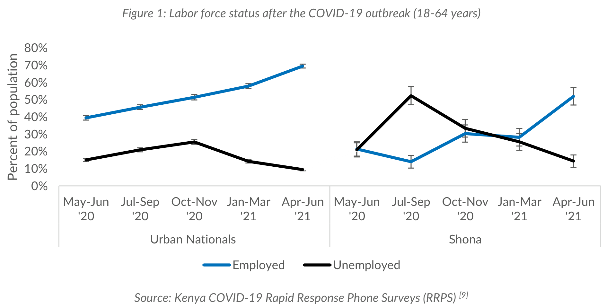
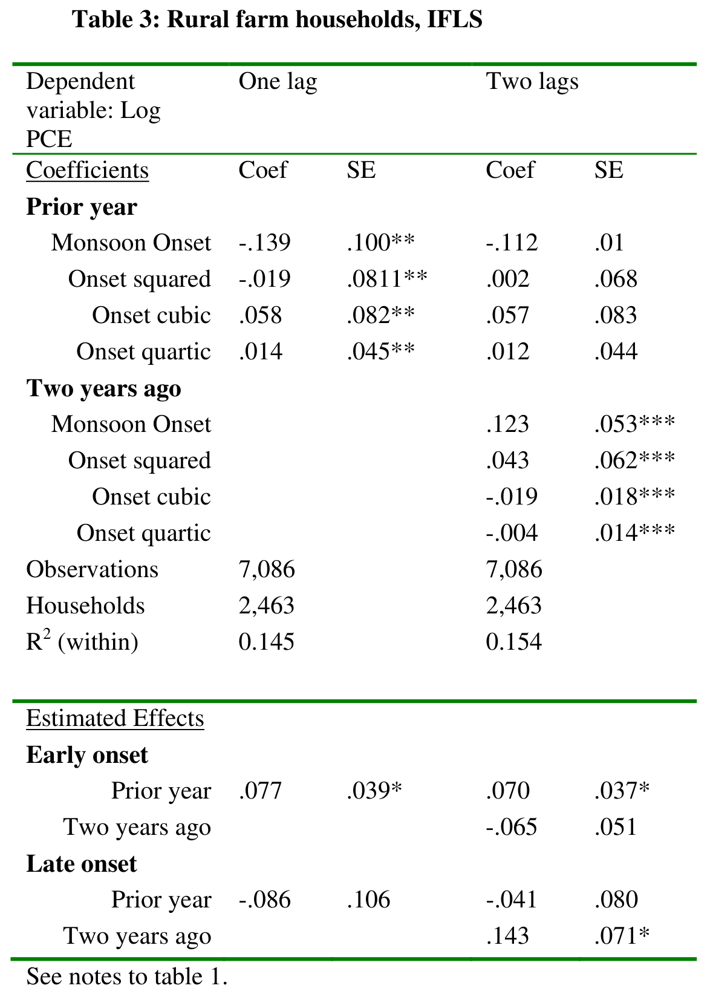
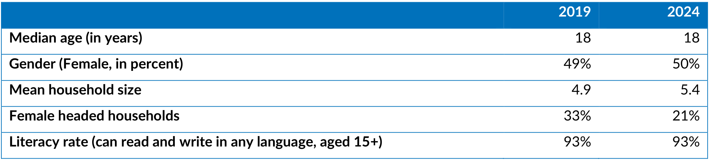
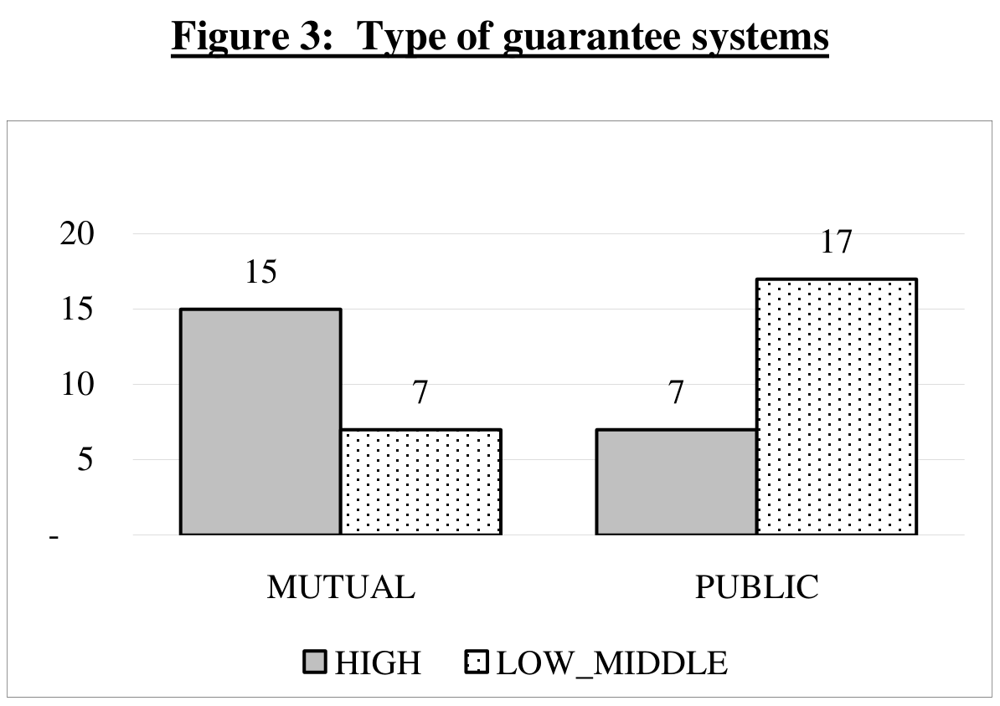

import Recipe from '@site/src/components/Cookbook/Recipe';
import Checklist from '@site/src/components/Cookbook/Checklist';

# 2. Experiment inputs and artifacts

**Question:** What must be prepared before the first round?

## Rationale

A metadata record describes the image supplied to the extractor. Two crops of the same table can expose different captions, notes, or values. A register needs to identify the exact crop and preserve its relationship to the source PDF. A semantic reference needs to describe that same image.

The initial policy, schema, model configuration, and experiment state establish the conditions for the first round. Versioned records make it possible to identify those conditions even after the policy has changed.

## Target state

- Each sample has an unambiguous image, provenance, role in the batch, and reference status.
- The manifest names the inputs and identifies the outputs of the proposed round.

## Maturity levels

| Level | Steps |
|---|---|
| **Foundational** | Review a small set of images and prepare a written baseline policy. |
| **AI-ready** | Register samples, record checksums, and link policy and state versions through a manifest. |
| **AI-native** | Specify automatic checks that verify the inputs and their versions before model calls. |

:::info[Running example]
D1 is the Shona labor-force figure. D2 is the rural Indonesia regression table. C1 is the cropped Shona demographics table. C2 is the WPS4771 guarantee-systems chart. The four images are real. Round 001 is an illustrative exercise.
:::

## Recipes

<Recipe title="2.1 Register the Discovery and Challenge samples" level="Foundational" skills="Data curator or experiment lead" time="45 minutes">

**Result:** A sample register documents the exact images, annotation availability, and source attribution.

Use the human-reviewed metadata release to identify candidate Discovery samples. Layout annotations identify a region on a PDF page. Semantic references describe the contents of the crop using Schema v1.4.

1. Open the source PDF and the selected image. Record the PDF page, source document ID, crop path, and SHA-256 checksum, which identifies the exact image bytes. Give the model a sample ID such as D1 that reveals no source information.
2. For Discovery, verify the annotation against visible cues such as the title, headings, and notes. Record the reference revision. For Challenge, document the gold listing checked and leave the reference empty.
3. Record the selection method and reserve separate documents for future evaluation. Group related crops and duplicate or near-duplicate documents when planning that separation.

**Worked example.** D1 is the crop with its caption and source. C1 shares its source PDF but uses the narrower production table crop without the caption or source line. D2's title, dependent variable, lag headings, and footer match the published semantic reference. C2 matches Figure 3 of WPS4771 on PDF page 15, printed page 12. The semantic gold release contains no matching C2 record. [Sample register](pathname:///cookbook-files/data-snapshot-metadata-council/samples.json) · [Attribution and reuse notes](pathname:///cookbook-files/data-snapshot-metadata-council/README.md)

**What this does not do.** A four-image batch supports a walkthrough. Its mix of document sources and crop types cannot establish representativeness.

</Recipe>

Inspect the four source crops

**D1.** The Shona labor-force chart retains its caption above the plot and its source below the legend.

**D2.** The rural Indonesia regression table places coefficient and standard-error columns under each lag specification.

**C1.** The crop shows year columns and row labels, including the median-age unit, while the caption lies outside the crop.

**C2.** The chart has a printed caption, two categories, and a legend. The vertical axis carries tick values without a unit label.

<Recipe title="2.2 Freeze the starting policy and state" level="AI-ready" skills="ML engineer and metadata reviewer" time="45 minutes">

**Result:** The experiment has a versioned starting policy, state, and settings to hold fixed.

The policy states what the extractor should do. The cumulative state carries decisions and unresolved questions between rounds. Keep the two separate so that a record of deliberation cannot silently change the instructions applied to an image.

1. Choose the schema and fixed reference extractor. Record provider and model identifier, model revision when available, request settings, and output format. Record the diagnostic judge and rubric as well.
2. Write the starting rules with persistent IDs. Specify the image evidence boundary and how to handle unsupported fields.
3. Initialize the state with the objective, current versions, access policy, and any prior decisions. Start with an empty history when this is the first round.

**Worked example.** P001 is a simplified teaching policy. Its four illustrative rules are separate from the packaged production prompts. S001 contains the objective and access boundary, with no prior extractions or decisions. The illustrated manifest leaves model identities and execution timestamps null because it represents a teaching round. [Initial policy](pathname:///cookbook-files/data-snapshot-metadata-council/001_policy.md) · [Initial experiment state](pathname:///cookbook-files/data-snapshot-metadata-council/001_experiment_state.md)

**What this does not do.** Recording versions and settings makes the experiment traceable. A hosted model may still return different outputs on repeated requests.

</Recipe>

<Recipe title="2.3 Link the round files in a manifest" level="AI-ready" skills="ML engineer" time="40 minutes">

**Result:** A round manifest connects the eight artifact types to the batch and its versioned inputs.

The manifest is the index of inputs and outputs for the round. Resolve its file paths from the folder containing `001_manifest.json`. Use the listed policy and state IDs to distinguish the starting files from the versions written for the next round.

| Artifact type | Contents and lifecycle |
|---|---|
| Extraction policy | P001 is applied in round 001. P002 is synthesized for future use. |
| Cumulative experiment state | S001 enters the round. S002 carries decisions and open questions forward. |
| Extraction results | One record per sample in JSON Lines format, with one JSON object per line. Each record identifies the policy used and contains its metadata output. |
| Round findings | Key issues, decision rationale, rule counts, rejected proposals, and open questions. |
| Council deliberation | Independent proposals, cross-critiques, revisions, and the orchestrator synthesis. |
| Round manifest | Batch membership, model and schema settings, status, timestamps where applicable, and artifact references. |
| Human review | Human decisions on escalated findings and any recorded spot checks. |
| Judge reviews | One structured review per sample, with its reference-comparison status and findings. |

1. Use the same sample and round IDs in the extraction and review records. Keep the metadata payload separate from experiment bookkeeping.
2. Resolve every path in the manifest and confirm its recorded version. Keep P001 and its extractions available after P002 is written.
3. Keep the sample register with the experiment files. Share only the files and fields each role needs, as shown in [chapter 3](./diagnosis.mdx).

**Worked example.** The manifest records P001 and S001 as inputs to the illustrative round and P002 and S002 as outputs of deliberation. Each extraction row names its sample and P001. These identifiers let the judge review a result against the policy in effect for that record. [Round manifest](pathname:///cookbook-files/data-snapshot-metadata-council/001_manifest.json) · [Illustrative extraction records](pathname:///cookbook-files/data-snapshot-metadata-council/001_extractions.jsonl)

**What this does not do.** The manifest records association and provenance. Image support and policy compliance require review.

</Recipe>

## Implementation options

- A small team can start with a spreadsheet for the register and exported JSON for the manifest. Agree on stable IDs before moving to scripts.
- Use deterministic selection and checksum checks for repeated batches. Keep role access separate from the public layout of the example files.

## Resources

- The [Data Snapshot corpus](https://huggingface.co/datasets/ai4data/data-snapshot) provides source documents, crops, and layout annotations.
- The [semantic gold release](https://huggingface.co/datasets/ai4data/data_snapshot_metadata_gold) provides human-reviewed references and a pinned v1.4 schema.
- The [Data Snapshot schema reference](/docs/data-snapshots/metadata-schema/) documents metadata fields and their validation boundaries.

## Common mistakes

- Joining by filename alone can pair a different crop with the annotation.
- Recording the proposed policy as the executed policy breaks comparisons.
- Treating a public dataset split name as evidence of evaluation independence can conceal prior use.

## Verification

- Resolve all four image paths and compare their hashes with the sample register.
- Validate each Discovery reference against the schema and verify the matching image by inspection.
- Verify that the extraction rows and manifest name P001 and that P002 is a round output.

## Checklist

<Checklist id="data-snapshot-metadata-council-preparation" items={[
  'The register identifies the exact crops and references.',
  'The starting policy, state, schema, and settings are recorded.',
  'The manifest distinguishes inputs and outputs and resolves all artifact paths.'
]} />
