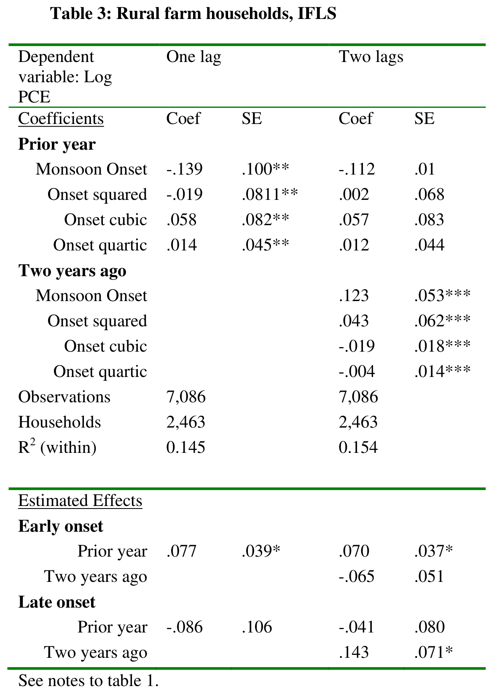
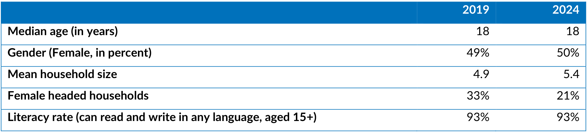

import Recipe from '@site/src/components/Cookbook/Recipe';
import Checklist from '@site/src/components/Cookbook/Checklist';

# 4. Human review of findings

**Question:** What needs a human decision before the council begins?

## Rationale

[Chapter 3](./start-round.mdx) ends at the point where the judge asks for a human decision about D2. The judge can point to the stars and the cross-reference in the table. The reviewer decides what the metadata should preserve when the data snapshot leaves their meaning open, and records why. A reviewer also decides whether the evidence warrants a correction to a human-reviewed annotation or a change to the schema.

A review with no flagged findings can still have missed a problem. A spot check tests selected fields and records the scope of the check. The council receives the relevant decisions and the image evidence so its proposals reflect what the review established.

## Target state

- Each finding that blocks deliberation has a recorded human decision and reason before the council begins.
- Each spot check names the fields examined and what the reviewer found.
- The council receives the relevant decisions and evidence. Full human-reviewed annotations stay with the judge and reviewer.

## Maturity levels

| Level | Steps |
|---|---|
| **Foundational** | Inspect the flagged evidence and record a decision. |
| **AI-ready** | Link escalations, decisions, and spot checks by sample and finding ID. |
| **AI-native** | Require blocking decisions and check the files available to council sessions before deliberation. |

:::info[Running example]
The illustrative review uses D2’s escalated finding F03 and C1’s unflagged review. The decisions appear as H01 and H02.
:::

## Recipes

<Recipe title="4.1 Resolve an escalated finding" level="Foundational" skills="Metadata reviewer" time="30 minutes">

**Result:** A human decision records what to keep or change and explains why.

Open D2’s finding F03 in the [judge reviews](pathname:///cookbook-files/data-snapshot-metadata-council/001_judge_reviews.jsonl). The judge asks whether preserving the visible cross-reference is sufficient for the metadata. The table below shows stars and the footer “See notes to table 1.” The referenced notes are outside the data snapshot.



1. Compare the flagged field in the [D2 extraction](pathname:///cookbook-files/data-snapshot-metadata-council/001_extractions.jsonl) with the image and the [human-reviewed annotation](pathname:///cookbook-files/data-snapshot-metadata-council/document_11174028_table_007.json). Use the [policy in effect (P001)](pathname:///cookbook-files/data-snapshot-metadata-council/001_policy.md) to check which evidence belongs in the record.
2. Decide what the metadata can say based on that evidence. Record the finding ID, the decision, and the reason, including any uncertainty that remains.
3. If a change to the annotation or schema is needed, record the approved change and its old and new versions. Preserve the original evidence.

**Worked example.** In the [human review record](pathname:///cookbook-files/data-snapshot-metadata-council/001_human_review.md), H01 keeps D2’s cross-reference and leaves the thresholds unspecified because the image does not establish them. The annotation and schema stay at the same versions.

**What this does not do.** H01 resolves the question of what to record for D2. The thresholds remain unknown from the image.

</Recipe>

<Recipe title="4.2 Spot-check a review and hand off the decisions" level="AI-ready" skills="Metadata reviewer and experiment lead" time="30 minutes">

**Result:** A spot check and any required human decisions are ready for the council.

C1’s [judge review](pathname:///cookbook-files/data-snapshot-metadata-council/001_judge_reviews.jsonl) lists the following scope and has no flagged findings.

```json
{
  "review_scope": "title, median age unit and year categories",
  "findings": []
}
```

Compare the selected fields in C1’s [extraction record](pathname:///cookbook-files/data-snapshot-metadata-council/001_extractions.jsonl) with the image below. The “Median age (in years)” row and the two year headings provide evidence for the fields in the review scope.



1. Select fields from an unflagged review and compare them with the image and the policy in effect. Record which fields were checked and whether the evidence supports them.
2. Confirm that findings requiring a human decision have one before deliberation starts. Include the relevant human decisions and image evidence with the judge’s findings.
3. Check that council sessions receive only the intended materials. Keep full human-reviewed annotations outside the files, tools, and session histories the council can access.

**Worked example.** H02 confirms the median-age unit and year categories in C1 and keeps its title null. The handoff can include this limited check and H01’s decision about D2. In [Chapter 5](./deliberation.mdx), the council uses those decisions alongside the images, extractions, and judge findings. [Illustrative human review](pathname:///cookbook-files/data-snapshot-metadata-council/001_human_review.md)

**What this does not do.** H02 covers only the named fields. A spot check does not measure the judge’s overall coverage or agreement with people.

</Recipe>

## Implementation options

- For a manual walkthrough, record the finding ID, evidence, and decision in a table alongside the fields selected for spot checks.
- In the proposed workflow, check that each blocking finding has a decision record before assembling the council inputs.

## Resources

- The [role instructions](pathname:///cookbook-files/data-snapshot-metadata-council/role-instructions.md) specify what human reviewers inspect and what can pass to the council.

## Common mistakes

- Treating an unflagged review as confirmation of all fields overstates its coverage.
- Resolving an ambiguity by supplying a value the image does not establish adds unsupported metadata.
- Passing a full reference annotation with a human decision gives the council more information than the review calls for.

## Verification

- Trace F03 to H01 and check that the decision states its evidence and reason.
- Compare the fields listed in H02 with the C1 image and extraction.
- Check that council-facing findings cite image evidence and that council sessions cannot reach full annotations.

## Checklist

<Checklist id="data-snapshot-metadata-council-diagnosis" items={[
  'Each blocking finding has a human decision and reason.',
  'Spot checks identify the fields reviewed and what the evidence supports.',
  'The council receives scoped findings and decisions.'
]} />
