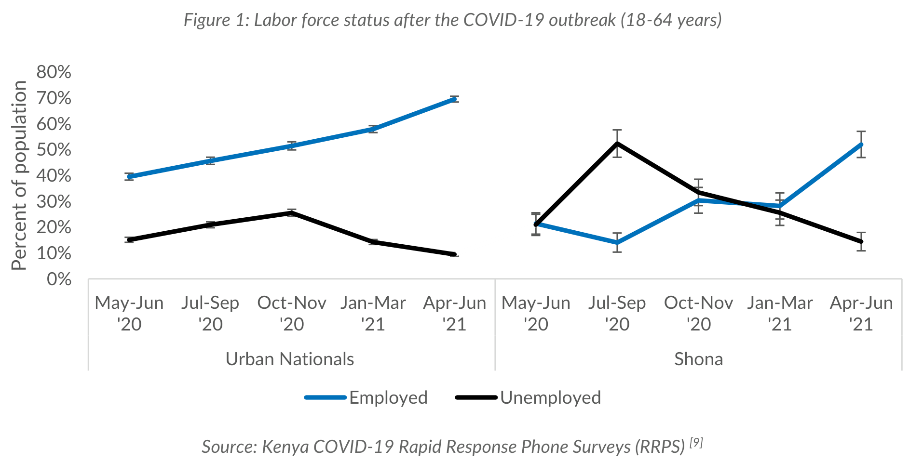

import Recipe from '@site/src/components/Cookbook/Recipe';
import Checklist from '@site/src/components/Cookbook/Checklist';

# 1. One round at a glance

**Question:** What does a round start with, and what does it produce?

## Rationale

Consider a chart whose axis label ends up in the title field. Correcting that record fixes one example. Refining the extraction policy means writing an instruction that helps the extractor distinguish a title from an axis label on other charts too.

The proposed experiment makes that reasoning explicit. A review identifies what went wrong and points to evidence in the data snapshot. A council of models proposes ways to address the problem, then challenges each proposal with other examples. A separate model, the orchestrator, combines the revised proposals into a candidate policy.

A prepared round makes that sequence easier to see before setting up a batch. Following D1 shows where the starting policy is used, what evidence reaches the council, and how the candidate policy and updated state carry decisions into the next round. The same extractor model applies each policy version so the experiment can focus on the instructions it follows.

## Target state

- The team can explain why the example's title error calls for a clearer instruction.
- A round connects the policy used for extraction, the evidence from review, and a candidate revision for the next batch.

## Maturity levels

| Level | Steps |
|---|---|
| **Foundational** | Identify a field that needs clearer guidance and trace one proposed revision. |
| **AI-ready** | Record the policy versions, evidence, and review decisions behind a revision. |
| **AI-native** | Design automated handoffs that check the evidence and preserve human review. |

:::info[Running example]
This chapter starts with the Shona labor-force chart, D1, and its illustrative extraction. The data snapshot and example outputs are already supplied. Chapter 2 covers how to prepare the full batch.
:::

## Recipes

<Recipe title="1.1 Identify the policy problem in D1" level="Foundational" skills="Experiment lead and metadata reviewer" time="30 minutes">

**Result:** A short note identifies the extraction error and explains what the policy needs to clarify.

Consider the prepared D1 data snapshot.



Then suppose its metadata includes the following field:

```json
{
  "title": "Percent of population"
}
```

To check this value, look at where the words appear. An axis label describes what the axis measures. A caption describes the chart as a whole.

1. Locate “Percent of population” in D1. Compare its placement with the caption above the chart.
2. Find rule R02 in the [starting policy (P001)](pathname:///cookbook-files/data-snapshot-metadata-council/001_policy.md). It says, “Record a visible title and document label when present.” Identify what distinction the model needs to make to follow that rule.
3. Write a short note naming the field, what went wrong, and what the rule should explain so the extractor can handle similar charts.

**Worked example.** Here is an example note for D1.

> The `title` field contains “Percent of population,” the label along the vertical axis. The caption is above the chart. R02 should explain how to tell a chart caption from an axis label when filling the `title` field.

**What this does not do.** One example can motivate a rule change. Its value on other data snapshots needs a separate check.

</Recipe>

<Recipe title="1.2 Trace a policy revision through one round" level="Foundational" skills="Experiment lead" time="30 minutes">

**Result:** A workflow map shows how an extraction issue reaches the candidate policy and identifies who handles each step.

Recipe 1.1 uses a manual review of D1’s metadata to show where the title rule needs clearer guidance. This recipe follows the same issue through an experiment round. In one round, the extractor applies the current policy to a batch of data snapshots, and the team uses the review of those results to decide what to change for the next batch.

In the hypothetical round 001, the extractor uses P001 and the judge records D1’s title error as finding F01. The council reviews that finding and recommends a change. The orchestrator incorporates the revised title rule into P002, the candidate policy for the next round. Follow the records below to see how each step leads to the next.

1. Open the [round 001 manifest](pathname:///cookbook-files/data-snapshot-metadata-council/001_manifest.json) to find the starting policy, state, and batch. The [starting state (S001)](pathname:///cookbook-files/data-snapshot-metadata-council/001_experiment_state.md) is where prior decisions and open questions would be recorded. The [sample register](pathname:///cookbook-files/data-snapshot-metadata-council/samples.json) identifies Discovery samples with human-reviewed annotations and Challenge samples without those annotations.
2. Find D1 in the [extraction records](pathname:///cookbook-files/data-snapshot-metadata-council/001_extractions.jsonl). The record names [P001](pathname:///cookbook-files/data-snapshot-metadata-council/001_policy.md), the policy in effect when the extractor produced the metadata.
3. Open the [judge reviews (`001_judge_reviews.jsonl`)](pathname:///cookbook-files/data-snapshot-metadata-council/001_judge_reviews.jsonl) and look for F01 in D1’s record. It explains why the image does not support the extracted title. The judge compares the output with the image, policy, and schema. For a Discovery sample such as D1, the judge also receives the full human-reviewed annotation, or gold reference. The human reviewer resolves escalated issues, spot-checks other records, and approves any changes to gold or schema.
4. Open the [council deliberation record](pathname:///cookbook-files/data-snapshot-metadata-council/001_deliberation.md) and look for F01 in Member A’s proposal. Follow that proposal through the other members’ critiques and A’s revision. Council members use the snapshots, outputs, judge findings, and relevant human decisions. The full gold references stay with the judge and human reviewer.
5. Compare the original R02 with the orchestrator’s revision in the [candidate policy (P002)](pathname:///cookbook-files/data-snapshot-metadata-council/002_policy.md). The candidate policy and the [updated state (S002)](pathname:///cookbook-files/data-snapshot-metadata-council/002_experiment_state.md) are the starting point for the next round.
6. Record that sequence in a table or diagram. Name the role, the record it reads, and the record it produces.

**Worked example.** The D1 workflow map follows the existing round records.

| Role | Reads | Produces |
|---|---|---|
| Reference extractor | D1 image and P001 | D1 extraction tagged with P001 by the runner. |
| Diagnostic judge | D1 image, extraction, policy, schema, and full reference | F01, which identifies the title error. |
| Council | Image evidence, extraction, findings, policy, state, and relevant human decisions | A revised proposal for R02. |
| Orchestrator | Proposals, critiques, and revisions | P002, S002, and the round findings. |

The output stays linked to P001, while P002 carries the revised instruction into the next round.

[Chapter 2](./preparation.mdx) shows how to register the data snapshots, record the starting policy and model settings, and link the round’s files in a manifest.

**What this does not do.** This trace shows how a candidate rule reaches the next round. Its effect on extraction quality requires a subsequent comparison.

</Recipe>

## Implementation options

- Use a table to record the steps from Recipe 1.2. For each step, name who acts, what they read, and what they produce. For example, the judge reads D1’s extraction and records finding F01.
- Use a flowchart to show how the records move between roles. Label the arrow from the judge to the council with F01, and the arrow from the council to the orchestrator with the revised proposal.

## Resources

- The [schema reference](/docs/data-snapshots/metadata-schema/) explains the extraction output contract.
- The [role instructions](pathname:///cookbook-files/data-snapshot-metadata-council/role-instructions.md) specify what each role receives and produces.

## Common mistakes

- Changing the reference extractor during a policy comparison makes it harder to attribute differences.
- Giving council members the full gold records bypasses the judge-mediated workflow.
- Treating P002 as the source of the round 001 extraction breaks the evidence trail.

## Verification

- Check that the note names the field, describes the error, and explains what the rule needs to clarify.
- Trace a sample from the registered image to its extraction, diagnostic review, and any resulting policy decision.
- Check that the map assigns full gold access and correction authority to the intended roles.

## Checklist

<Checklist id="data-snapshot-metadata-council-workflow" items={[
  'The note identifies an extraction error and what the policy needs to clarify.',
  'The workflow starts with a policy, state, and two sample batches.',
  'The policy used for extraction and the candidate policy are distinguishable.'
]} />
