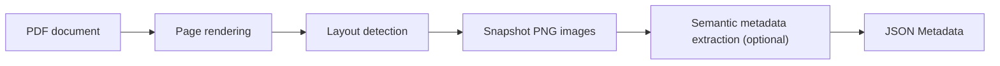

# Data Snapshots

Data Snapshots is a tool for extracting analytical figures and tables from PDF documents as PNG images and optionally generating structured semantic metadata about their content. The resulting files can be inspected individually or used in downstream data discovery and analysis workflows.

## The Challenge

Institutional reports often contain valuable analytical information in figures and tables that text-based extraction cannot fully capture. Extracting these artifacts requires preserving their visual structure and contextual information, including titles, legends, and footnotes.

Generic layout detectors can identify figures and tables, but may also select irrelevant content, fragment composite visualizations, or omit important context. Furthermore, document-level metadata cannot adequately describe the variables, units, geographic coverage, or time periods represented by individual artifacts.

## What is a Data Snapshot?

A **data snapshot** is a bounded visual region within a document containing structured or semi-structured information intended for analytical interpretation or reuse. Examples include statistical tables, analytical charts, maps, dashboards, and composite figures. Contextual elements such as titles, legends, captions, and footnotes may be necessary to interpret the artifact.

[](/img/snapshot/workflow-overview.svg)

*Sample page and crop from
[Policy Research Working Paper 4771](https://documents.worldbank.org/curated/en/937071468314370786/pdf/The-typology-of-partial-credit-guarantee-funds-around-the-world.pdf#page=15),
page 12 (PDF page 15), as used in the
[data-snapshot dataset](https://huggingface.co/datasets/ai4data/data-snapshot).
Metadata generation is optional; the JSON is illustrative. Select the figure to
view it at full size.*

## How It Works

The default production workflow is implemented in `ai4data.data_snapshot`:



1. **Page rendering.** The tool converts each PDF page into an image that the
   detector can inspect.
2. **Layout detection and cropping.** DocLayout-YOLO, the default detector,
   locates figure and table regions. The tool saves those regions as PNG images.
   Other supported detectors include YOLO11, YOLO26, and TF-ID-Large.
3. **Semantic metadata extraction.** A vision-language model, which processes
   images and text instructions, describes the content of each snapshot. It uses
   evidence visible within the image, including labels, legends, and notes.
4. **Validation and saving.** The tool validates the model's structured response
   against [Data Snapshot Metadata Schema v1.4](metadata-schema.md) and saves the
   metadata as JSON. Validation checks the representation; it does not guarantee
   that the description is factually correct or complete.

The [production README](https://github.com/worldbank/ai4data/blob/main/src/ai4data/data_snapshot/README.md)
documents the supported detectors, configuration, and Python interfaces.

## Using the Outputs

The tool produces snapshot images and, optionally, semantic metadata files. These outputs can support several downstream applications:

- **Organization and indexing**: Use metadata to categorize snapshots by subject, variables, units, geographic coverage, and time periods.
- **Search and retrieval**: Build systems that help researchers find relevant analytical figures and tables across document collections.
- **Downstream processing**: Use extracted snapshots as inputs to numerical transcription, further analysis, and other data discovery workflows.

Search, numerical transcription, catalogs, and publication services are downstream
applications; the production module does not implement them. The PNG preserves
the detected visual region, while the JSON describes its meaning. Neither output
is a verified dataset of the numerical observations shown in the image.

## Getting Started

### Prerequisites and installation

The workflow requires Python 3.11 or later, a checkout of the
[repository](https://github.com/worldbank/ai4data), and local PDF files.
Use Python from the intended environment. From the repository root, install the
default detector and metadata dependencies:

```bash
python -m pip install ".[data-snapshot,data-snapshot-metadata]"
```

These instructions use the source checkout: the production README notes that
`ai4data==0.1.0` does not include these extras. Model weights may download on the
first detector run.

Metadata generation requires a key for the selected external model provider.
OpenRouter is the default; set `OPENROUTER_API_KEY` in the environment or a local
`.env` file excluded from version control. OpenAI is also supported with
`--metadata-provider=openai` and `OPENAI_API_KEY`. Metadata requests send the
snapshot images to that provider and consume provider credits. Snapshot-only
extraction makes no metadata API requests.

### Commands

The following are three entry points for different stages of the same workflow.
Replace `data/example.pdf` with an existing PDF. A directory of PDFs is also
accepted.

**Combined snapshot and metadata extraction.** This command runs the default
detector and generates metadata for the new crops:

```bash
python -m ai4data.data_snapshot --input=data/example.pdf
```

**Snapshot-only extraction.** This command saves PNG crops without generating
metadata:

```bash
python -m ai4data.data_snapshot.extract_data_snapshot --input=data/example.pdf
```

**Metadata-only extraction.** This command generates missing metadata from
existing snapshot images, without rerunning the snapshot extraction:

```bash
python -m ai4data.data_snapshot.extract_metadata \
  --input=output/doclayoutyolo/snapshots
```

Add `--help` to any command for its options.

### Example outputs

For `example.pdf`, a run that finds one figure and one table would produce this
directory structure after metadata extraction:

```text
output/doclayoutyolo/
├── snapshots/example_figure_000.png
├── snapshots/example_table_000.png
├── metadata/example_figure_000.json
└── metadata/example_table_000.json
```

The [Metadata Schema reference](metadata-schema.md) explains the fields, nested
structures, and validation rules. Metadata fields without supporting evidence in the snapshot may be null.

## Limitations and Future Directions

The current Data Snapshots workflow has several limitations:

- **Snapshot detection.** Layout detectors may extract irrelevant content, miss analytical artifacts, or capture incomplete regions. Composite figures and contextual elements such as titles, legends, and footnotes are particularly challenging. Extracted images should be reviewed against their source pages.
- **Metadata accuracy.** Metadata extraction may omit visible information or generate incorrect interpretations. Validation against the metadata schema ensures structural consistency but does not guarantee factual accuracy or completeness.
- **Workflow scope.** The tool produces snapshot images and semantic metadata but does not perform numerical transcription, verify individual observations, or provide built-in review and catalog publication workflows.
- **Provenance and evaluation.** The pipeline does not persist source-page coordinates or extraction history alongside its outputs. Additionally, the published extraction benchmark evaluates layout detection and spatial accuracy, not the accuracy of the current metadata extraction process.

Future improvements could include more complete snapshot boundaries, metadata quality assessment and review, extraction provenance tracking, and integration with downstream discovery and publication systems. These remain potential extensions rather than capabilities of the current tool.

## References and Resources

**Scientific background**

- [Benchmarking Open-Source Layout Detection Models for Data Snapshot Extraction from Institutional Documents](https://arxiv.org/abs/2606.06242v1) defines the extraction task and reports the benchmark methods, results, and limitations.
- *Artifact-Driven Metadata Schema Development: A Human-in-the-Loop Methodology with Multimodal LLMs*  (publication pending) documents the schema-development methodology.

**Documentation, code, and data**

- [Metadata Schema reference](metadata-schema.md) documents the current production Schema v1.4.
- [Production module](https://github.com/worldbank/ai4data/tree/main/src/ai4data/data_snapshot) and [README](https://github.com/worldbank/ai4data/blob/main/src/ai4data/data_snapshot/README.md) provide implementation, installation, configuration, troubleshooting, and API details.
- [Data Snapshot dataset](https://huggingface.co/datasets/ai4data/data-snapshot) contains the released PDFs and annotations for the extraction benchmark.
- [Experimental benchmarking and evaluation code](https://github.com/worldbank/ai4data/tree/main/experimental/data-snapshot) supports annotation and region evaluation in a separate research environment.
- [Experimental schema-development code](https://github.com/ajdajd/data-snapshot/blob/main/notebooks/schema_discovery/README.md) records discovery, human adjudication, and schema-validation research. Its historical schemas are distinct from the current production contract.

**Related cookbooks**

- [Extracting Data from Documents](/cookbook/data-from-documents/) covers the broader document-to-data workflow, including numerical extraction and verification.
- [Metadata Curation with Language Models](/cookbook/metadata-curation-with-llms/) covers metadata review and quality assessment.
- [AI-Ready Data Dissemination](/cookbook/ai-ready-dissemination/) covers downstream access, provenance, and dissemination.
