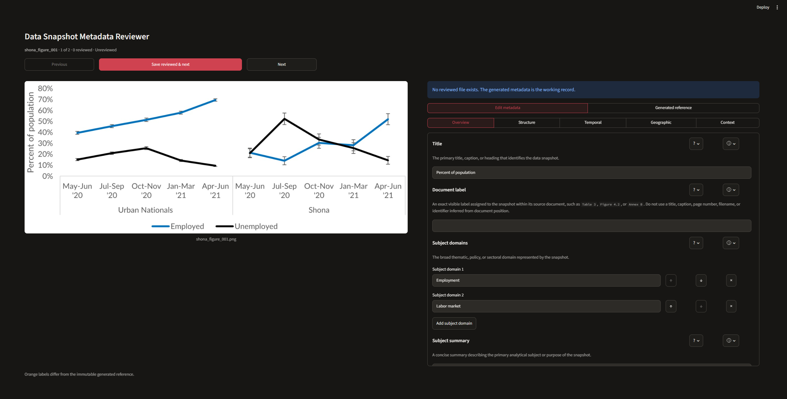

# Data Snapshot Metadata Reviewer



Review generated metadata beside its data snapshot, edit structured fields,
and save a separate human-reviewed JSON record. The app uses ai4data's canonical
Data Snapshot Metadata Schema v1.4. It runs locally, with no model weights,
LLM provider, or API key.

## Install and launch

Requires Python 3.11 or newer. Until a release includes this app, install from
the ai4data repository root:

```bash
python -m pip install ".[data-snapshot-metadata-reviewer]"
python -m ai4data.data_snapshot.metadata_reviewer
```

The launcher serves Streamlit at `http://127.0.0.1:8501` and uses Streamlit's
default browser behavior. Desktop sessions normally open your default browser;
Linux sessions without a display run headlessly. You can override this behavior
through Streamlit configuration or the `STREAMLIT_SERVER_HEADLESS` environment
variable. If a browser does not open automatically, open the address printed in
the terminal. Use Ctrl+C to stop the server.

The command works outside the checkout after installation; paths are relative
to the terminal's working directory. Reinstall after changing source files, or
use an editable install (`pip install -e ".[data-snapshot-metadata-reviewer]"`).

The default directories are the pipeline's outputs:

```text
output/doclayoutyolo/
├── snapshots/example_figure_000.png
├── metadata/example_figure_000.json
└── reviewed/example_figure_000.json  # created by Save reviewed & next
```

For another extraction run, supply its snapshot directory. The other roots
default to sibling `metadata` and `reviewed` directories:

```bash
python -m ai4data.data_snapshot.metadata_reviewer \
  --snapshots-root output/yolo11/snapshots
```

To use three custom locations:

```bash
python -m ai4data.data_snapshot.metadata_reviewer \
  --snapshots-root /path/to/images \
  --generated-root /path/to/generated-json \
  --reviewed-root /path/to/reviewed-json
```

This is the human editor for data snapshots. The separate `metadata-reviewer`
extra supplies the agent-based reviewer for dataset documentation.

## Matching files

The app searches directories recursively for PNG, JPEG, GIF, and WebP images
and JSON metadata. Images and JSON match by their exact, case-sensitive filename
stem: `example_figure_000.png` matches `example_figure_000.json`. Stems must be
unique within each root. Duplicate stems stop discovery; unmatched files appear
as warnings and are excluded from review.

Flat and nested folders are supported without source or artifact-type folder
requirements. New reviewed files mirror the image's relative path with a
`.json` extension. An existing reviewed JSON with the same stem is reused even
if it is elsewhere under the reviewed root. The reviewed root must be separate
from both input roots: it cannot equal, contain, or be inside either root.

Input JSON must be an object that validates against the canonical schema.
Malformed or incompatible input records are reported before editing; correct
those files outside the app before continuing.

## Review and save

1. The app opens the first image without a reviewed file. Existing reviewed
   metadata becomes the working record; otherwise generated metadata fills
   the form.
2. Inspect the image beside the **Overview**, **Structure**, **Temporal**,
   **Geographic**, and **Context** sections. Missing fields have editable blank
   placeholders. Add, reorder, or remove nested items where needed.
3. Use field definitions and schema examples to interpret each field. The **?**
   popover shows its generated value. Orange labels mark differences from the
   generated reference, which is also available as a complete JSON view.
4. Select **Save reviewed & next**. The app validates the whole record before
   saving. Errors identify field paths and leave the draft and existing saved
   file intact.

Saving without edits records that a human accepted the generated metadata.
A file's existence marks it as reviewed; it does not establish semantic
correctness or benchmark ground truth. Check each value against visible image
evidence. The app cannot recover omitted image context or discover missed
artifacts; compare with the source PDF separately when assessing completeness.

**Previous** and **Next** protect unsaved edits with **Save & move**,
**Discard & move**, and **Cancel** choices. Drafts exist only in the browser
session: there is no autosave, and closing or reloading the session can lose
unsaved work.

## File behavior

- Images and generated JSON are read-only inputs. Saves target reviewed JSON.
- Saving an already reviewed item replaces its reviewed file atomically.
- Saved JSON uses the canonical model's text normalization and exact-list
  deduplication, and omits null fields. Missing and null object fields compare
  equally in the editor.
- Use one reviewer per output directory. There is no conflict detection for
  concurrent edits or external changes.
- Review status is based on file existence. If you regenerate images or
  metadata, move prior reviewed outputs aside before starting a fresh review.

## Development

From the repository root:

```bash
python -m pip install -e ".[data-snapshot-metadata-reviewer]" pytest
python -m pytest tests/data_snapshot/test_metadata_reviewer*.py -q
```

The tests use temporary image and JSON files, including Streamlit's app test
runner. CI also installs the built wheel and runs the Data Snapshot suite.

Adapted from the metadata reviewer in the `data-snapshot-annotation` research
repository at `ef6952b326b263d48099eb32d7aa3ac71acf1f17`. Dataset-specific
discovery, notebook paths, and evaluation workflows are excluded; the existing
ai4data schema is reused.
